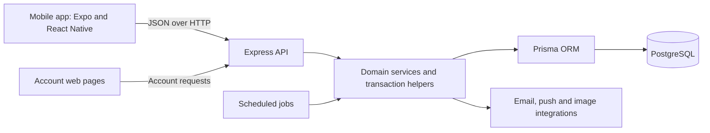

# RankUp

### Gamified productivity, backed by a mobile client and a transactional API

[Türkçe](README_TR.md) · [Architecture](docs/architecture-overview.md)

RankUp is a mobile productivity project that connects daily tasks with XP, ranks, achievement badges and social challenges. It explores how individual progress, friendly competition and shared goals can fit into one application while keeping rewards and account state consistent on the server.

This repository is a portfolio showcase for software engineering applications. It contains documentation and reserved screenshot areas; the application source remains private.

**Status:** In development. Described features are implemented in the reviewed source; an app-store release and device acceptance have not been verified. Updated: **October 2026**.

## Engineering highlights

- **End-to-end development:** React Native / Expo mobile client, Express REST API, Prisma and PostgreSQL.
- **Consistency under concurrency:** transaction-safe task rewards, repeat-safe duel/co-op settlement and request idempotency.
- **Reliable account flows:** rotating refresh sessions, guarded account switching and push-delivery state handling.

> **Source-code access:** The application repository is private. This public portfolio contains a technical overview only; no application code, credentials or user data.

## Project scope

The project combines mobile UI development, API design, relational data modeling, authentication and asynchronous background processing. Its central engineering concern is making task completion and social rewards behave consistently when requests overlap, networks fail or users switch accounts.

## Technology stack

| Area | Technologies used in the implementation |
| --- | --- |
| Mobile | React Native, React, Expo, TypeScript, Expo Router |
| UI and interaction | NativeWind/Tailwind CSS, React Native Reanimated, gesture handling, SVG and chart components |
| Client state and storage | React Context, Expo SecureStore for authentication tokens, AsyncStorage for cached user state and preferences |
| Backend | Node.js, Express, JavaScript with CommonJS modules |
| Persistence | PostgreSQL, Prisma ORM, versioned SQL migrations |
| Account services | bcrypt, JSON Web Tokens, Nodemailer for email workflows |
| Notifications and media | Expo Notifications/Push integration, Cloudinary profile-image integration |
| Supporting web pages | HTML, CSS and JavaScript for verification, password reset and account deletion |
| Verification and tooling | Node.js test runner, PostgreSQL integration tests, TypeScript checks, ESLint, GitHub Actions |

These technologies were checked against dependency manifests and their use in source files. Provider integration does not imply a verified live deployment.

## Application capabilities

| Capability | Implemented behavior |
| --- | --- |
| Accounts and sessions | Registration and login, email verification, password reset/change, rotating refresh tokens, session revocation and account deletion |
| Task tracking | Task-pool selection, custom tasks, daily completion and same-day undo, with server-calculated XP and coin rewards |
| Progress | Twelve rank levels, streaks, weekly activity summaries, category breakdowns and a configurable weekly active-day goal |
| Challenges and achievements | Daily, weekly and event challenge periods; progress-based reward claims; achievement badges and a selectable profile badge showcase |
| Social features | Friend requests, friend profiles, global and friends leaderboards |
| Duels | Invitations and acceptance, XP/category/streak race modes, in-app coin stakes, server-computed scores and guarded result settlement |
| Co-op quests | Two-person task-completion goals, optional category filtering, shared progress, contribution display and completion rewards |
| Personalization | Avatar customization, coin purchases of avatar parts and cosmetics, ownership/equipment checks and profile images |
| Onboarding and reminders | Persisted goal/category setup, notification inbox, push registration, notification preferences and quiet hours |
| Motivation | Animated mascot scenes and contextual motivational messages |

Coins are an in-app reward balance. This showcase makes no claim of payment processing or real-money purchases.

The profile also supports a limited free streak-protection action. It affects the displayed profile streak; it does not create a task completion or award XP/coins.

## Architecture at a glance

The mobile app separates routes, reusable components, context providers, typed API services and domain types. The backend uses route modules, authentication/validation middleware, controllers, services and shared helpers. Some social workflows live in controllers and helpers rather than a uniform service layer.

PostgreSQL is the durable source for task completions, sessions, relationships, purchases and match results. Scheduled jobs reconcile matches and process notification delivery. The API remains responsible for reward rules and ownership decisions.

[Read the architecture overview](docs/architecture-overview.md) for data flows, consistency decisions and trade-offs.

## Engineering examples

### Repeated taps and concurrent rewards

A completion request can arrive twice or overlap with an undo. Task changes and primary rewards run in a database transaction, with a user-row lock and daily completion uniqueness enforced by SQL migrations. Undo checks whether the reward can be reversed; insufficient balance rejects the operation without deleting the completion.

This demonstrates transaction boundaries, concurrency handling and database-enforced invariants.

### Session refresh during account changes

Multiple API requests can encounter an expired session together. The client shares one refresh operation, while authentication generations and serialized storage writes guard against old responses restoring a previous account. The backend rotates refresh-token hashes and checks persisted session revocation. Mutations are not automatically replayed after refresh.

This demonstrates asynchronous state management across network, UI and local storage.

### Settling a match more than once

A task update and a scheduled job can both discover that a duel or co-op has ended. The finalizers acquire participant locks, re-read durable state and conditionally transition an ongoing match inside a transaction before awarding rewards. Match creation also supports idempotency keys.

This demonstrates state-machine reasoning and repeat-safe background processing.

### Reliable notifications with explicit uncertainty

Notification identity is deduplicated in the database. Delivery records track individual device bindings and attempts; session ownership and registration generations prevent stale bindings from becoming the current recipient. Explicit transient failures can be retried, while an unknown send outcome is retained for review instead of blindly sent again. Provider acceptance is distinct from visibility on a device.

This demonstrates delivery-state modeling and a practical limit of external-service guarantees.

## Screenshots

Screenshots will be added after a review using synthetic accounts and fictional task data. No images are included yet.

| Reserved view | Planned file | What it will show |
| --- | --- | --- |
| Home and tasks | `screenshots/home.png` | Daily tasks, XP and progress summary |
| Progress | `screenshots/progress.png` | Ranks, charts and weekly activity |
| Social play | `screenshots/social.png` | Duel and co-op interfaces |
| Shop and avatar | `screenshots/avatar-shop.png` | Customization and in-app coin purchases |
| Profile | `screenshots/profile.png` | Badges, weekly goal and profile streak |

[Screenshot preparation notes](screenshots/README.md)

## Development status and verification

| Area | Current status |
| --- | --- |
| Listed application flows | Implemented in the inspected mobile/backend source; not a claim that every acceptance test is complete |
| Economy ledger | Implemented behind an isolated-test activation gate; production activation remains outside the demonstrated scope |
| Tests and CI | Regression tests and GitHub Actions workflows exist; they were inspected, not executed for this documentation task |
| Quality gates | Lint/dependency-audit work remains; the showcase does not claim passing release gates |
| Release and device acceptance | Open work remains in release-readiness and physical-device checklists; no store release is claimed |
| Portfolio media | Screenshot slots prepared; sanitized captures pending |

Claims in this showcase were prepared from private-project documentation and source inspection; detailed file-path evidence remains private. This showcase does not claim measured performance, production usage or complete test coverage.
