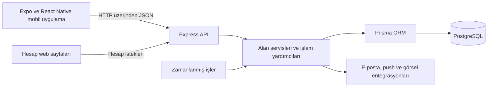

# RankUp

### Mobil istemci ve işlemsel API üzerine kurulu, oyunlaştırılmış üretkenlik uygulaması

[English](README.md) · [Mimari](docs/architecture-overview.md)

RankUp; günlük görevleri XP, rütbe, başarı rozetleri ve sosyal meydan okumalarla birleştiren bir mobil üretkenlik projesidir. Bireysel ilerlemeyi, arkadaşlar arası rekabeti ve ortak hedefleri aynı uygulamada bir araya getirirken ödül ve hesap durumunun sunucuda tutarlı kalmasını ele alır.

Bu depo, yazılım mühendisliği iş başvuruları için hazırlanmış bir portfolyo sunumudur. Dokümantasyon ve ekran görüntüsü alanları içerir; uygulamanın kaynak kodu gizli tutulur.

**Durum:** Geliştirme aşamasında. Açıklanan özellikler incelenen kaynak kodunda uygulanmış durumda; mağaza yayını ve gerçek cihaz kabulü doğrulanmadı. Güncelleme: **Ekim 2026**.

## Öne çıkan mühendislik çalışmaları

- **Uçtan uca geliştirme:** React Native / Expo mobil istemci, Express REST API, Prisma ve PostgreSQL.
- **Eşzamanlı işlemlerde tutarlılık:** transaction tabanlı görev ödülleri, tekrar çalıştırmaya dayanıklı düello/co-op sonuçlandırması ve istek tekilleştirme.
- **Güvenilir hesap akışları:** döndürülen refresh token oturumları, hesap değişiminde eski yanıtların engellenmesi ve bildirim teslimat durumları.

> **Kaynak kodu erişimi:** Asıl uygulama deposu gizlidir. Bu portfolyoda yalnızca teknik açıklamalar bulunur; kaynak kodu, kimlik bilgileri ve kullanıcı verileri paylaşılmaz.

## Amaç ve kapsam

Proje; mobil arayüz geliştirme, API tasarımı, ilişkisel veri modelleme, kimlik doğrulama ve arka plan işlemlerini birleştirir. Temel teknik odak, istekler çakıştığında, ağ bağlantısı kesildiğinde veya kullanıcı hesap değiştirdiğinde görev tamamlamalarının ve sosyal ödüllerin tutarlı işlenmesidir.

## Kullanılan teknolojiler

| Alan | Uygulamada kullanılan teknolojiler |
| --- | --- |
| Mobil | React Native, React, Expo, TypeScript, Expo Router |
| Arayüz ve etkileşim | NativeWind/Tailwind CSS, React Native Reanimated, dokunma/kaydırma etkileşimleri, SVG ve grafik bileşenleri |
| İstemci durumu ve depolama | React Context, kimlik doğrulama tokenları için Expo SecureStore, kullanıcı önbelleği ve tercihler için AsyncStorage |
| Backend | Node.js, Express, CommonJS modülleriyle JavaScript |
| Veri katmanı | PostgreSQL, Prisma ORM, sürümlü SQL migration dosyaları |
| Hesap servisleri | bcrypt, JSON Web Token, e-posta akışları için Nodemailer |
| Bildirim ve medya | Expo Notifications/Push entegrasyonu, profil görselleri için Cloudinary entegrasyonu |
| Yardımcı web sayfaları | Doğrulama, parola sıfırlama ve hesap silme için HTML, CSS ve JavaScript |
| Doğrulama ve araçlar | Node.js test çalıştırıcısı, PostgreSQL entegrasyon testleri, TypeScript kontrolleri, ESLint, GitHub Actions |

Teknolojiler bağımlılık dosyalarından ve kod içindeki kullanımlarından doğrulandı. Bir sağlayıcı entegrasyonunun bulunması, canlı ortamda doğrulandığı anlamına gelmez.

## Temel uygulama özellikleri

| Yetenek | Kodda bulunan davranış |
| --- | --- |
| Hesap ve oturum | Kayıt/giriş, e-posta doğrulama, parola sıfırlama/değiştirme, refresh token rotasyonu, oturum iptali ve hesap silme |
| Görev takibi | Görev havuzundan seçim, özel görev oluşturma, günlük tamamlama ve aynı gün geri alma; sunucuda hesaplanan XP/coin ödülleri |
| İlerleme | On iki rütbe seviyesi, görev serileri, haftalık etkinlik özeti, kategori dağılımları ve düzenlenebilir haftalık aktif gün hedefi |
| Challenge ve başarılar | Günlük/haftalık/etkinlik dönemleri, ilerlemeye bağlı ödül alma, başarı rozetleri ve seçilebilir profil rozet vitrini |
| Sosyal özellikler | Arkadaşlık istekleri, arkadaş profilleri, genel ve arkadaş sıralamaları |
| Düello | Davet ve kabul, XP/kategori/seri yarışı modları, uygulama içi coin ortaya koyma, sunucuda skor hesaplama ve kontrollü sonuçlandırma |
| Co-op görevleri | İki kişilik görev tamamlama hedefi, isteğe bağlı kategori filtresi, ortak ilerleme, katkı gösterimi ve tamamlama ödülleri |
| Kişiselleştirme | Avatar düzenleme, coin ile avatar parçası/kozmetik satın alma, sahiplik/kullanım denetimleri ve profil görselleri |
| Başlangıç ve hatırlatmalar | Kalıcı hedef/kategori kurulumu, bildirim kutusu, push kaydı, bildirim tercihleri ve sessiz saatler |
| Motivasyon | Animasyonlu maskot sahneleri ve bağlama göre motivasyon mesajları |

Coin, uygulama içi ödül bakiyesidir. Bu sunum ödeme işleme veya gerçek parayla satın alma yeteneği iddia etmez.

Profilde sınırlı, ücretsiz seri koruma işlemi de bulunur. Bu işlem profilin gösterdiği seriyi etkiler; görev tamamlama kaydı oluşturmaz ve XP/coin kazandırmaz.

## Genel mimari

Mobil tarafta rotalar, tekrar kullanılabilir bileşenler, context sağlayıcıları, tipli API servisleri ve alan tipleri ayrılmıştır. Backend; rota modülleri, kimlik doğrulama/doğrulama middleware'leri, controller'lar, servisler ve ortak yardımcılar kullanır. Bazı sosyal akışlar tek tip bir servis katmanı yerine controller ve yardımcı dosyalarda yer alır.

Görev tamamlamaları, oturumlar, ilişkiler, satın almalar ve karşılaşma sonuçları PostgreSQL'de kalıcı olarak tutulur. Zamanlanmış işler karşılaşmaları uzlaştırır ve bildirim teslimatını işler. Ödül kuralları ve sahiplik kararları API'nin sorumluluğundadır.

Veri akışları ve tasarım sınırları için [mimari özetine](docs/architecture-overview.md) bakılabilir.

## Teknik problem ve çözüm örnekleri

### Tekrarlanan dokunmalar ve eşzamanlı ödüller

Bir tamamlama isteği iki kez gelebilir veya geri alma işlemiyle çakışabilir. Görev değişiklikleri ve temel ödüller; kullanıcı satırı kilidi ve SQL migration'larıyla sağlanan günlük tamamlama benzersizliğiyle birlikte veritabanı transaction'ında işlenir. Geri alma sırasında ödülün düşülebilmesi kontrol edilir; bakiye yetersizse tamamlama kaydı silinmeden işlem reddedilir.

Bu akış; transaction sınırlarını, eşzamanlılık yönetimini ve veritabanında korunan tutarlılık kurallarını gösterir.

### Hesap değişirken oturum yenileme

Birden fazla API isteği aynı anda süresi dolmuş oturumla karşılaşabilir. İstemci ortak bir yenileme işlemi kullanır; kimlik doğrulama nesilleri ve sıralı yerel depolama yazımları, eski yanıtların önceki hesabı geri yüklemesini engellemeye yöneliktir. Backend, saklanan refresh token hash'ini yeniler ve kalıcı oturum iptalini kontrol eder. Veri değiştiren istekler yenileme sonrasında otomatik tekrarlanmaz.

Bu akış; ağ, arayüz ve yerel depolama arasındaki asenkron durum yönetimini gösterir.

### Bir karşılaşmanın birden fazla kez sonuçlandırılması

Görev güncellemesi ve zamanlanmış iş aynı düello/co-op'un bittiğini görebilir. Sonuçlandırma kodu katılımcı kilitlerini alır, kalıcı durumu tekrar okur ve ödül vermeden önce devam eden karşılaşmayı transaction içinde koşullu olarak sonlandırır. Karşılaşma oluşturma istekleri ayrıca idempotency anahtarlarını destekler.

Bu akış; durum geçişlerini ve tekrar çalıştırılabilen arka plan işlemlerini gösterir.

### Belirsizliği açıkça modelleyen bildirim teslimatı

Bildirim kimliğinin tekrar oluşması veritabanında engellenir. Teslimat kayıtları cihaz bağlarını ve denemeleri ayrı izler; oturum sahipliği ve kayıt nesilleri eski bağların güncel alıcı olmasını önlemeye yöneliktir. Açık geçici hatalar yeniden denenebilir; sonucu belirsiz gönderim ise körlemesine tekrar gönderilmez, inceleme için korunur. Sağlayıcı kabulü ile cihazda görünme ayrı durumlardır.

Bu akış; teslimat durumlarının modellenmesini ve harici servis garantilerinin pratik sınırlarını gösterir.

## Ekran görüntüleri

Görseller, sentetik hesaplar ve kurgusal görev verileriyle hazırlanıp kontrol edildikten sonra eklenecek. Henüz görsel bulunmuyor.

| Ayrılan görünüm | Planlanan dosya | Gösterilecek içerik |
| --- | --- | --- |
| Ana sayfa ve görevler | `screenshots/home.png` | Günlük görevler, XP ve ilerleme özeti |
| İlerleme | `screenshots/progress.png` | Rütbeler, grafikler ve haftalık etkinlik |
| Sosyal oyun | `screenshots/social.png` | Düello ve co-op arayüzleri |
| Mağaza ve avatar | `screenshots/avatar-shop.png` | Kişiselleştirme ve coin ile satın alma |
| Profil | `screenshots/profile.png` | Rozetler, haftalık hedef ve profil serisi |

[Ekran görüntüsü hazırlama notları](screenshots/README.md)

## Geliştirme ve doğrulama durumu

| Alan | Mevcut durum |
| --- | --- |
| Listelenen uygulama akışları | İncelenen mobil/backend kodunda uygulanmış; bütün kabul testlerinin tamamlandığı iddia edilmiyor |
| Ekonomi işlem defteri | İzole test aktivasyon kapısıyla uygulanmış; üretimde aktif olduğu gösterilmiyor |
| Testler ve CI | Regresyon testleri ve GitHub Actions iş akışları var; bu dokümantasyon çalışmasında incelendi, çalıştırılmadı |
| Kalite kapıları | Proje kayıtlarında açık lint/bağımlılık denetimi bulguları var; tüm CI kontrollerinin başarılı olduğu söylenemez |
| Yayın ve cihaz kabulü | Yayın hazırlığı ve fiziksel cihaz listelerinde açık işler var; mağaza yayını iddia edilmiyor |
| Portfolyo görselleri | Alanlar hazır; kişisel veri içermeyen görüntüler bekleniyor |

Açıklamalar, özel projedeki dokümantasyon ve kaynak kodu incelemesi temel alınarak hazırlandı; ayrıntılı dosya eşleştirmeleri gizli tutuluyor. Ölçülmüş performans, üretim kullanımı veya eksiksiz test kapsamı iddiası bulunmaz.
